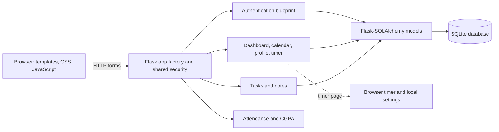

# Zenara

Zenara is a personal study workspace for planning work and making room to focus. It brings together a task list, personal notes, a calendar, a browser-based Pomodoro timer, and two academic calculators.

See the [original project walkthrough](Zenara_DemoVideo_compressed.mp4).

## Features

- Account signup and login with bcrypt password hashing, CSRF protection, secure session settings, and authentication rate limits.
- Tasks, notes, and calendar events stored in SQLite and scoped to the signed-in account.
- Attendance calculator with input validation and the 75% threshold.
- Credit-weighted CGPA estimate on a 4.0 scale (A = 4, B = 3, C = 2, D = 1, F = 0).
- Pomodoro focus and break intervals that run in the browser, with adjustable durations, saved preferences, and a generated browser chime.
- Responsive HTML/CSS interface with accessible labels and status messages.

## Architecture



The application is created by `zenara.create_app()` and exposed for Flask and WSGI by `app.py`. Routes are grouped in blueprints. Shared account and study records are relational models; the timer stays in the browser and does not create shared server state.

## Tech stack

- **Backend:** Python 3.10+, Flask 3.x, Flask blueprints
- **Database:** SQLite, Flask-SQLAlchemy, SQLAlchemy 2.x, Flask-Migrate/Alembic schema revisions
- **Security:** bcrypt, Flask-WTF CSRF protection, Flask-Limiter
- **Frontend:** Jinja templates, semantic HTML, responsive CSS, vanilla JavaScript
- **Production server:** Gunicorn on Unix-like hosts; Flask's built-in server is for local development only

## Run locally

Use Python 3.10 or newer.

```powershell
py -m venv .venv
.venv\Scripts\Activate.ps1
python -m pip install -r requirements.txt
Copy-Item .env.example .env
```

Replace `ZENARA_SECRET_KEY` in `.env` with a randomly generated value. For example, run `python -c "import secrets; print(secrets.token_hex(32))"` and copy its output. Then initialize the database and start the development server:

```powershell
flask --app app db upgrade
flask --app app run
```

Open `http://127.0.0.1:5000` and create an account. The default SQLite database lives at `instance/zenara.db`; the `instance` folder is ignored by Git.

On macOS or Linux, activate the environment with `source .venv/bin/activate`. The same `flask --app app db upgrade` and `flask --app app run` commands apply.

## Production configuration

Set `ZENARA_ENV=production`, a stable high-entropy `ZENARA_SECRET_KEY`, a database URL, and `ZENARA_RATE_LIMIT_STORAGE_URI` to a shared store such as Redis. Run behind HTTPS and set `ZENARA_COOKIE_SECURE=1`. Do not enable `ZENARA_DEBUG` in production. A multi-worker deployment must use the same signing key and shared rate-limit storage for every worker.

For a basic Unix deployment, apply pending migrations during release, then run:

```sh
flask --app app db upgrade
gunicorn --bind 0.0.0.0:8000 --workers 2 app:app
```

Database schema changes are versioned under `migrations/`; review generated revisions before applying them. SQLite is suitable for local use and modest single-instance traffic. Use a managed database for a larger multi-instance deployment.

## Run tests

Install the development dependencies and run the test suite from the project root:

```sh
python -m pip install -r requirements-dev.txt
python -m pytest
```

The tests cover signup and login behavior, protected pages, calculator results and input validation, and task ownership. The data-isolation test verifies that one account cannot view, toggle, or delete another account's tasks.

## Import old JSON data

The original `tasks.json` and `notes.json` files are retained as source data and are not read during normal app use. If you want to import those shared demo records into one empty account, create that account, run `flask --app app import-legacy`, and enter its email address. The command leaves the original JSON files untouched and prevents repeat imports into accounts with existing study data. Import only into the intended account because the old files did not record an owner.

## Project structure

```text
app.py                    WSGI entry point
zenara/
  __init__.py             app factory, configuration, security headers, CLI commands
  auth.py                 signup, login, logout
  calculators.py          validated calculator endpoints
  extensions.py           database and CSRF extensions
  main.py                 dashboard, calendar, profile, focus timer
  models.py               user, task, note, and event models
  productivity.py         user-scoped tasks and notes
  security.py             authentication decorator
  static/                 CSS and browser JavaScript
  templates/              Jinja pages
migrations/                versioned database schema changes
instance/                 local SQLite database (not committed)
```

## Contribution notes

The previous README names Lekhyasree Medarametla, Nilaya Reddy Metta, Parineetha KR, and Prachita Chauhan. A legacy sample note also names Manvi. Confirm the contributor list and document each person's own work before publishing or describing this as a team project on a resume.
